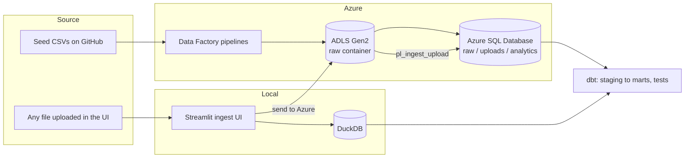

# jaffle-shop-dbt: an analytics pipeline on dbt, DuckDB and Azure

An end-to-end data pipeline for a fictional online shop, extended from dbt Labs' sample project
[`jaffle_shop_duckdb`](https://github.com/dbt-labs/jaffle_shop_duckdb) (Apache 2.0; their original
README is kept in [`docs/UPSTREAM_README.md`](docs/UPSTREAM_README.md)).

**What came from dbt Labs:** the three seed files and the five original models (staging views for
customers, orders and payments, plus the `customers` and `orders` marts).

**What was added in this repo:** everything else listed below.

[**Live dbt docs and lineage graph**](https://apurv-panbude24.github.io/jaffle-shop-dbt/)

## Architecture



The same dbt models run on two engines: `dev` (local DuckDB, seeds) and `prod` (Azure SQL, landing
tables loaded by Data Factory).

## What I added

**dbt project**
- A marts layer: `customer_segments` (lifetime-value segments with tunable thresholds),
  `daily_revenue` (incremental, `delete+insert` with a lookback window so reruns are idempotent) and
  `payment_method_mix` (revenue share per payment method).
- Three kinds of tests: generic (including a custom `non_negative`), singular (an order's total must
  equal the sum of its per-method amounts) and a dbt unit test for the segment boundaries.
- Models written to be valid on both DuckDB and SQL Server (`dbt.dateadd`, `case` flags, casts before
  division), with a `raw_table` macro that switches the source by target.

**Azure** (all defined as code in [`infra/azure`](infra/azure), Bicep)
- ADLS Gen2 landing zone, Azure SQL Database on the free serverless offer, and Data Factory.
- A Data Factory pipeline that copies the CSVs from GitHub to ADLS and then into SQL, on a daily trigger.
- Keyless access between services (managed identity), a monthly budget alert, and a teardown script.

**Ingest UI** ([`app/`](app/README.md))
- A Streamlit app: upload a CSV, TSV, Parquet or Excel file, see a summary and charts, and optionally
  send it through ADLS and a generic Data Factory pipeline into Azure SQL, with a row-count check.
- Column names are tidied to `snake_case`; types are inferred and mapped to SQL Server types.

**Automation**
- CI on every pull request: sqlfluff on the new code, `dbt build` (seeds, models, data and unit tests),
  an incremental re-run check, and docs generation.
- A nightly scheduled build with a run summary, and dbt docs published to GitHub Pages.

## Run it

Requirements: [`uv`](https://docs.astral.sh/uv/getting-started/installation/) (it installs Python 3.13).

```bash
uv sync
uv run dbt build                       # local DuckDB: seeds, models, tests
uv run dbt docs generate && uv run dbt docs serve
uv run streamlit run app/ingest_app.py # the ingest UI
uv run pytest tests_app                # unit tests for the UI logic
```

Azure setup and the `prod` target are described in [`infra/azure/README.md`](infra/azure/README.md).
You need your own Azure subscription; the free tier covers this project, and
`infra/azure/teardown.sh` removes everything.

## Checks

| Check | Result |
|---|---|
| `dbt build` on DuckDB | 3 seeds, 8 models, 32 data tests, 1 unit test: all pass |
| `dbt build --target prod` on Azure SQL | same models and tests, identical results |
| `pytest tests_app` | 33 tests |
| CI | lint and build on every pull request |

## Design decisions

- **Two engines, one set of models.** Developing on DuckDB is instant and free; the Azure target proves
  the SQL is portable and not engine-specific.
- **Incremental with a lookback window.** Late-arriving rows are picked up, and `delete+insert` on the
  date key keeps reruns from duplicating data.
- **Tests at three levels.** Generic tests guard column rules, a singular test reconciles totals across
  tables, and a unit test pins down the segmentation logic independently of the data.
- **Infrastructure as code with a teardown.** Everything in Azure can be recreated from the repo and
  removed with one command, with a budget alert as a safety net.
- **CI lint is scoped to the new code.** The upstream models predate the style config and were left
  untouched. `daily_revenue.sql` is excluded because it uses `dbt.dateadd`, which plain sqlfluff cannot
  resolve; dbt still builds and tests it on both engines.

## Limitations

- This is a learning and portfolio project on a small fictional dataset, not a production platform.
- Uploads to Azure replace the target table rather than appending, and the pipeline runs as the SQL
  admin login rather than a least-privilege account.
- The Azure target is run from a developer machine; CI builds only the DuckDB target.
- There is no orchestrator beyond Data Factory triggers and scheduled GitHub Actions.

## License

Apache 2.0, as in the upstream project (see [`LICENSE`](LICENSE)).
